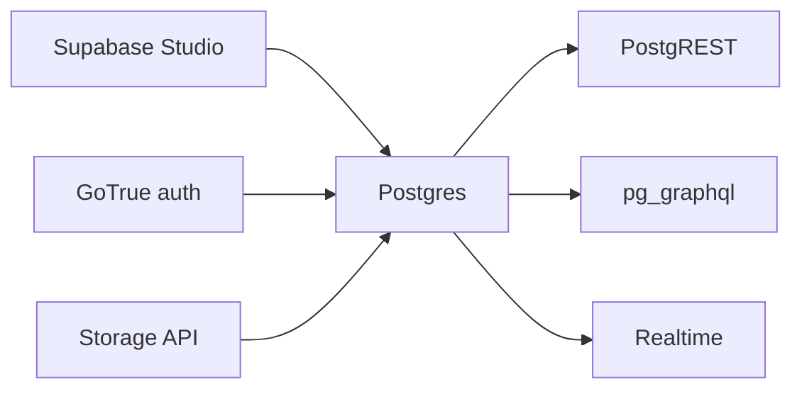

# supabase/supabase

> Plateforme de développement autour de Postgres, alternative libre à Firebase, hébergée ou auto-hébergée.

## Le problème
Un back-end d'application demande base, authentification, API, temps réel et stockage, soit beaucoup d'assemblage.

## Ce que ça fait vraiment
Elle combine Postgres, PostgREST (API REST), pg_graphql, GoTrue (authentification JWT), Realtime (Elixir, écoute des changements), Storage (S3), postgres-meta et le proxy Envoy, derrière un tableau de bord (Studio). Elle ajoute des fonctions Edge et une boîte à outils vecteurs et embeddings. Clients officiels JavaScript, Flutter, Swift et Python, d'autres communautaires.

## Comment c'est branché


## Essayer
```bash
# aucune commande dans le README : inscription sur supabase.com ou guide d'auto-hébergement dans la documentation
```

## Coût et pièges
Palier gratuit sur la plateforme hébergée, compte à créer. L'auto-hébergement demande d'exploiter plusieurs services.

## Ce que ce n'est pas
Pas un simple Postgres managé : c'est une pile complète. Pas une copie un pour un de Firebase.

## Alternatives
Aucune alternative nommée dans le README.

## Pour toi
À adopter pour un back-end rapide avec Postgres et vecteurs (pgvector via la boîte à outils IA) sur un prototype ou un outil interne.

