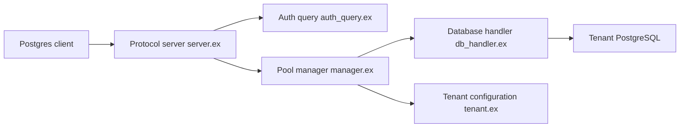

# supabase/supavisor

> Clustered, multi-tenant Postgres connection pooler to absorb millions of clients.

## The problem
Postgres copes poorly with a very large number of connections, especially from serverless environments that connect constantly.

## What it actually does
Supavisor receives client connections, starts a pool per tenant, authenticates the client and relays traffic to a small number of native Postgres connections. Tenant configuration is stored in a Postgres database. A cluster shares the location of pools between nodes. It exposes Prometheus metrics and an OpenAPI API. Transaction mode is supported; session pooling is listed as future work.

## How it is wired

## Trying it
No command in the README provided: it points to the Installation and Usage pages, which are not included.

## Cost and gotchas
Free, but you must deploy a cluster and a Postgres configuration database. README benchmark: about 90% of PgBouncer's throughput locally. Several features (read balancing, caching, high availability) are still to do.

## What it is not
Not a proven replacement for PgBouncer for every use: session mode does not exist yet. Not a serverless tool: it does not run in serverless.

## Alternatives
PgBouncer, pgcat, odyssey, pgpool, pgagroal (cited as inspirations in the README).

## For you
Worth watching: good to know if your AI services or notebooks saturate Postgres with connections, but PgBouncer is often enough before reaching that scale.
