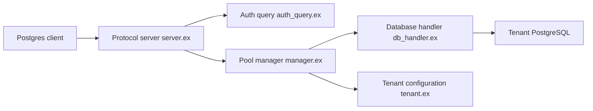

# supabase/supavisor

> Pooleur de connexions Postgres en cluster, multi-tenant, pour absorber des millions de clients.

## Le problème
Postgres tient mal un très grand nombre de connexions, surtout depuis des environnements serverless qui se connectent sans cesse.

## Ce que ça fait vraiment
Supavisor reçoit les connexions clientes, démarre un pool par tenant, authentifie le client et relaie le trafic vers un petit nombre de connexions Postgres natives. La configuration des tenants est stockée dans une base Postgres. Un cluster partage l'emplacement des pools entre nœuds. Il expose des métriques Prometheus et une API OpenAPI. Le mode transaction est supporté, la session pooling est listée comme futur.

## Comment c'est branché

## Essayer
Aucune commande dans le README fourni : il renvoie vers les pages Installation et usage, non incluses.

## Coût et pièges
Gratuit, mais il faut déployer un cluster et une base de configuration Postgres. Benchmark du README : environ 90 % du débit de PgBouncer en local. Plusieurs fonctions (équilibrage de lecture, cache, haute disponibilité) sont encore à faire.

## Ce que ce n'est pas
Pas un remplaçant éprouvé de PgBouncer pour tous les usages : le mode session n'existe pas encore. Pas un outil serverless : il ne tourne pas en serverless.

## Alternatives
PgBouncer, pgcat, odyssey, pgpool, pgagroal (cités comme inspirations dans le README).

## Pour toi
Surveiller : à connaître si tes services IA ou notebooks saturent Postgres de connexions, mais PgBouncer suffit souvent avant d'avoir cette échelle.

