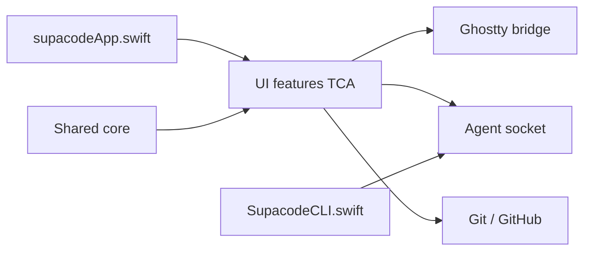

# supabitapp/supacode

> Native macOS application to run several coding agents in parallel, each in its own git worktree.

## The problem
Running several coding agents in parallel leads to file collisions and to sessions lost when the terminal is closed.

## What it actually does
Each task gets its own git worktree and a real terminal (libghostty). Sessions run in the zmx daemon and survive closing the app or an SSH connection. It detects the agent (Claude, Codex, Copilot) through hooks it installs, shows its state and notifies. A `supacode` CLI and deeplinks drive the app; GitHub PR tracking in the sidebar.

## How it is wired


## Trying it
```bash
git clone --recursive git@github.com:supabitapp/supacode.git
cd supacode
mise install
make doctor
make run-app
```

## Cost and gotchas
Free but requires macOS 26.0+; GhosttyKit is compiled with Zig, and Xcode 26.3 is required on macOS 26.4+. The architecture shows telemetry and crash reports in the app.

## What it is not
Neither an agent nor a model orchestrator: it is a terminal interface around existing agents. Not available outside macOS.

## Alternatives
- No alternative named in the README.

## For you
Ignore unless you are on macOS 26 and launch many agents in parallel; unidentified license and heavy build.
