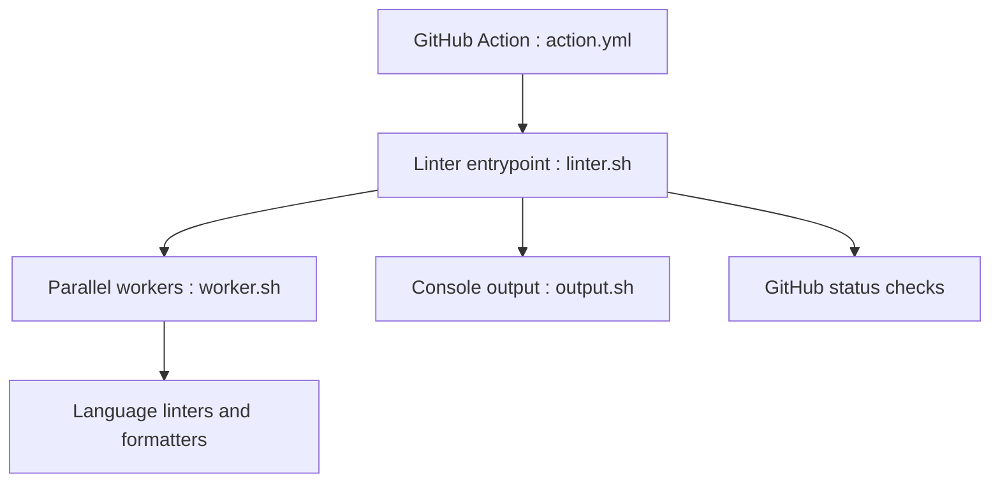

# super-linter/super-linter

> Ready-to-use collection of linters, in a container, to validate a repository's code in CI.

## The problem
Setting up one linter per language, with its configuration, in every repository is slow and inconsistent.

## What it actually does
A container image bundles linters and formatters for many languages. It detects changed files, runs the linters in parallel and reports in the console and in GitHub Actions statuses. A fix mode applies repairs. Configuration goes through environment variables.

## How it is wired


## Trying it
```yaml
- name: Super-linter
  uses: super-linter/super-linter@v9.0.0
  env:
    GITHUB_TOKEN: ${{ secrets.GITHUB_TOKEN }}
```
To be placed in a GitHub Actions workflow with `fetch-depth: 0`.

## Cost and gotchas
Free, MIT license. Requires Docker or GitHub Actions. The standard image is large; a `slim` variant removes a few linters. Pin a full version for reproducibility. The provided README is truncated in the variables table.

## What it is not
It is not a single linter: it orchestrates existing tools. It does not replace tests.

## Alternatives
No alternative named in the README.

## For you
Adopt: a single CI step checks Python, YAML, Dockerfile and shell, useful for varied MLOps repositories.
