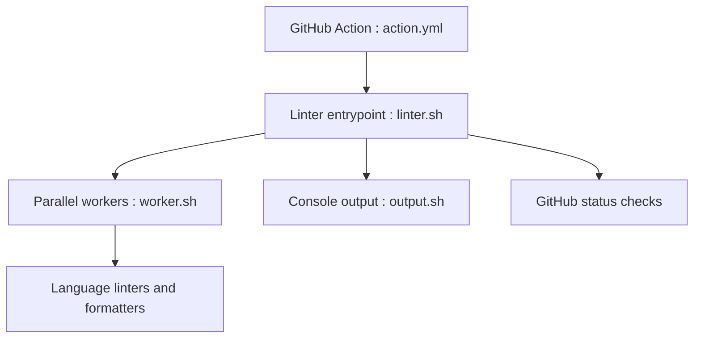

# super-linter/super-linter

> Collection de linters prête à l'emploi, en conteneur, pour valider le code d'un dépôt en CI.

## Le problème
Mettre en place un linter par langage, avec sa configuration, dans chaque dépôt, est long et incohérent.

## Ce que ça fait vraiment
Une image conteneur regroupe des linters et des formateurs pour de nombreux langages. Elle détecte les fichiers modifiés, lance les linters en parallèle et rapporte dans la console et dans les statuts de GitHub Actions. Un mode correction applique les réparations. La configuration passe par des variables d'environnement.

## Comment c'est branché


## Essayer
```yaml
- name: Super-linter
  uses: super-linter/super-linter@v9.0.0
  env:
    GITHUB_TOKEN: ${{ secrets.GITHUB_TOKEN }}
```
À placer dans un workflow GitHub Actions avec `fetch-depth: 0`.

## Coût et pièges
Gratuit, licence MIT. Il faut Docker ou GitHub Actions. L'image standard est volumineuse ; une variante `slim` retire quelques linters. Épingler une version complète pour la reproductibilité. Le README fourni est tronqué dans le tableau des variables.

## Ce que ce n'est pas
Ce n'est pas un seul linter : il orchestre des outils existants. Il ne remplace pas les tests.

## Alternatives
Aucune alternative nommée dans le README.

## Pour toi
Adopter : une seule étape de CI vérifie Python, YAML, Dockerfile et shell, utile pour des dépôts MLOps variés.

