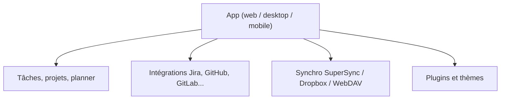

# super-productivity/super-productivity

> Private, offline, open source to-do list, time tracker and daily planner.

## The problem
Tracking your tasks and work time without entrusting your data to a cloud account.

## What it actually does
README and identity identical to johannesjo/super-productivity (same stars, same creation date): the same project under the new organization name. Planner, Kanban, Pomodoro timer, Jira, GitHub, GitLab integrations, SuperSync, Dropbox, WebDAV sync.

## How it is wired


## Trying it
```bash
# Aucune commande documentée dans ce README : télécharger depuis le wiki ou ouvrir la web app.
```

## Cost and gotchas
Free, no account. Web version limited compared to desktop.

## What it is not
Apparent duplicate of johannesjo/super-productivity in the catalog: do not count it twice. Not a team tool.

## Alternatives
No named alternative in the README.

## For you
Watch, like its duplicate johannesjo/super-productivity: good local time tracking, outside the data / AI core.
