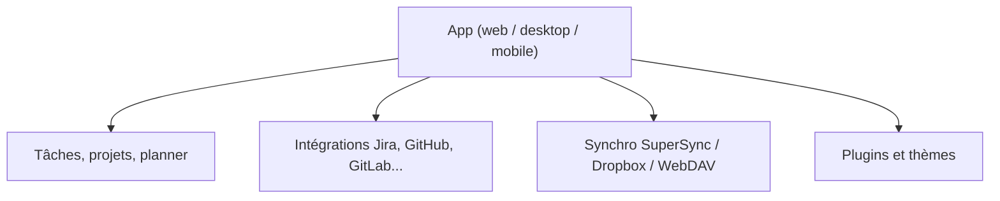

# super-productivity/super-productivity

> Liste de tâches, suivi du temps et planificateur quotidien, privé, hors ligne et open source.

## Le problème
Suivre ses tâches et son temps de travail sans confier ses données à un compte cloud.

## Ce que ça fait vraiment
README et identité identiques à johannesjo/super-productivity (mêmes étoiles, même date de création) : même projet sous le nouveau nom d'organisation. Planner, Kanban, minuteur Pomodoro, intégrations Jira, GitHub, GitLab, synchro SuperSync, Dropbox, WebDAV.

## Comment c'est branché


## Essayer
```bash
# Aucune commande documentée dans ce README : télécharger depuis le wiki ou ouvrir la web app.
```

## Coût et pièges
Gratuit, sans compte. Version web limitée par rapport au bureau.

## Ce que ce n'est pas
Doublon apparent de johannesjo/super-productivity dans le catalogue : ne pas le compter deux fois. Pas un outil d'équipe.

## Alternatives
Aucune alternative nommée dans le README.

## Pour toi
À surveiller, comme son doublon johannesjo/super-productivity : bon suivi du temps local, hors du cœur data / IA.

