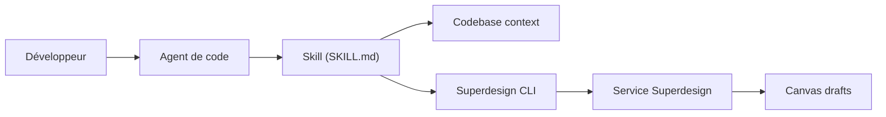

# superdesigndev/superdesign-skill

> Skill for coding agents that generates interfaces, presentations and charts through the Superdesign service.

## The problem
Coding agents write good code but generic interfaces, with no design direction.

## What it actually does
- Installs a skill for Claude Code, Cursor, Codex and 70+ other agents.
- Searches for style references, extracts a site's "design DNA", writes `.superdesign/design-system.md`.
- Creates design drafts on a canvas (iteration, branches), multi-page flows, presentations and charts.
- Drives the `@superdesign/cli` CLI: generation happens on the hosted superdesign.dev service.

## How it is wired


## Trying it
```bash
npx skills add superdesigndev/superdesign-skill
npm install -g @superdesign/cli@latest
superdesign login
superdesign search-prompts --query "<keyword>"
superdesign create-project --title "X" --template ./index.html
```
For Claude Code: `/plugin marketplace add superdesigndev/superdesign-skill` then `/plugin install superdesign@superdesign`.

## Cost and gotchas
A superdesign.dev account is required; the service's pricing is not documented in the README. The skill sends context from your code to the service. Avoid combining `npx skills add` and the Claude Code plugin (two copies).

## What it is not
Not a local generator: the design engine is proprietary and hosted; only the skill is open source (MIT). Not the old VS Code extension, which is archived.

## Alternatives
No alternative named in the README (it compares itself to theme skills without naming them).

## For you
Ignore: oriented toward interface design and tied to a SaaS requiring an account; outside the data/AI/MLOps core.
