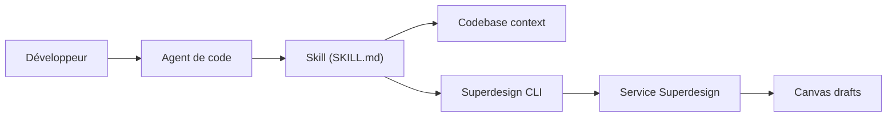

# superdesigndev/superdesign-skill

> Skill pour agents de code qui génère interfaces, présentations et graphiques via le service Superdesign.

## Le problème
Les agents de code écrivent du bon code mais des interfaces génériques, sans direction de design.

## Ce que ça fait vraiment
- Installe un skill pour Claude Code, Cursor, Codex et 70+ autres agents.
- Cherche des références de style, extrait le « design DNA » d'un site, écrit `.superdesign/design-system.md`.
- Crée des brouillons de design sur un canevas (itération, branches), des parcours multi-pages, des présentations et des graphiques.
- Pilote la CLI `@superdesign/cli` : la génération se fait sur le service hébergé superdesign.dev.

## Comment c'est branché


## Essayer
```bash
npx skills add superdesigndev/superdesign-skill
npm install -g @superdesign/cli@latest
superdesign login
superdesign search-prompts --query "<keyword>"
superdesign create-project --title "X" --template ./index.html
```
Pour Claude Code : `/plugin marketplace add superdesigndev/superdesign-skill` puis `/plugin install superdesign@superdesign`.

## Coût et pièges
Compte superdesign.dev requis ; le tarif du service n'est pas documenté dans le README. Le skill envoie du contexte de ton code au service. Éviter de cumuler `npx skills add` et le plugin Claude Code (deux copies).

## Ce que ce n'est pas
Pas un générateur local : le moteur de design est propriétaire et hébergé ; seul le skill est open source (MIT). Pas l'ancienne extension VS Code, archivée.

## Alternatives
Aucune alternative nommée dans le README (il se compare à des skills de thèmes sans les nommer).

## Pour toi
À ignorer : orienté design d'interface et lié à un SaaS à compte ; hors cœur data/IA/MLOps.

