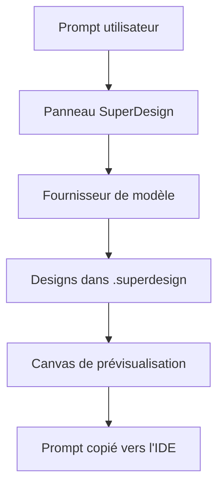

# superdesigndev/superdesign

> IDE extension that generates interface mockups, components and wireframes from a prompt, for developers.

## The problem
Going from an interface idea to a usable mockup requires a design tool separate from the editor.

## What it actually does
A side panel in Cursor, Windsurf, Claude Code or VS Code. You type a prompt, the agent produces screens, components or wireframes, which you can fork and then copy into your project. Designs are stored locally in `.superdesign/`. A local OpenAI-compatible provider is possible (LM Studio).

## How it is wired

Diagram not provided: simplified diagram based on the README.

## Trying it
```bash
# Aucune commande dans le README : installer l'extension depuis le Marketplace Cursor/VS Code,
# ouvrir le panneau SuperDesign, puis taper un prompt.
# Canvas : cmd + shift + p -> superdesign: open canva
```

## Cost and gotchas
Model provider API key at your expense. The repository is no longer maintained: the product has become a web application.

## What it is not
Not an active project: the README says so at the top, this is the original extension (2025) kept for the record. The license is present but not identified.

## Alternatives
- superdesign-skill (named in the README): the same agent, usable as a skill from Claude Code or Cursor.
- The web product www.superdesign.dev: this is the maintained version.

## For you
Worth watching only for the idea: the repository is frozen, the successor is a web service, of little use for data/MLOps work.
