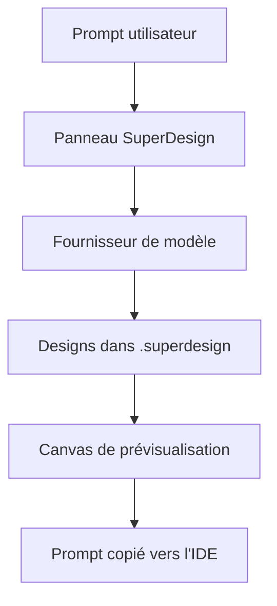

# superdesigndev/superdesign

> Extension IDE qui génère maquettes, composants et wireframes d'interface depuis un prompt, pour développeurs.

## Le problème
Passer d'une idée d'interface à une maquette exploitable demande un outil de design séparé de l'éditeur.

## Ce que ça fait vraiment
Un panneau latéral dans Cursor, Windsurf, Claude Code ou VS Code. On saisit un prompt, l'agent produit écrans, composants ou wireframes, que l'on peut forker puis copier dans son projet. Les designs sont stockés en local dans `.superdesign/`. Un fournisseur compatible OpenAI local est possible (LM Studio).

## Comment c'est branché

Schéma non fourni : diagramme simplifié d'après le README.

## Essayer
```bash
# Aucune commande dans le README : installer l'extension depuis le Marketplace Cursor/VS Code,
# ouvrir le panneau SuperDesign, puis taper un prompt.
# Canvas : cmd + shift + p -> superdesign: open canva
```

## Coût et pièges
Clé d'API du fournisseur de modèle à ta charge. Le dépôt n'est plus maintenu : le produit est devenu une application web.

## Ce que ce n'est pas
Pas un projet actif : le README le dit en tête, c'est l'extension d'origine (2025) conservée pour l'historique. La licence est présente mais non identifiée.

## Alternatives
- superdesign-skill (nommé dans le README) : le même agent, utilisable comme skill depuis Claude Code ou Cursor.
- Le produit web www.superdesign.dev : c'est la version maintenue.

## Pour toi
À surveiller seulement pour l'idée : le dépôt est figé, le successeur est un service web, peu utile pour un travail data/MLOps.

