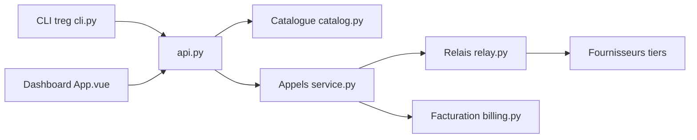

# superdesigndev/treg

> Tool registry and proxy for agents: one token, a catalog of pay-per-call APIs, for teams.

## The problem
An agent that needs SEO data, enrichment or scraping requires an account and a key per provider, and team keys circulate in plain text.

## What it actually does
The server resolves the tool from the URL host, decrypts the secret (Fernet), injects it into the request, streams the response back and writes an audit log. A catalog of thousands of endpoints is billed to the cent against a prepaid balance; a team's own key takes precedence and is not billed. It also manages CLIs, skills, teams and roles, a Claude Code plugin and an MCP connector.

## How it is wired


## Trying it
```bash
curl -fsSL https://treg.to/install.sh | sh
treg login
treg catalog search "backlinks for a domain"
treg balance
uv sync
uv run python -m treg
```

## Cost and gotchas
The hosted service (treg.to) requires an account; $1 offered once, then a prepaid balance. Self-hosting is possible: losing `TREG_SECRET_KEY` makes the secrets unrecoverable. The CLI sends usage statistics to PostHog, which can be disabled (`TREG_TELEMETRY=0`).

## What it is not
Not a simple client: the service centralizes keys and payments, hence trust. A catalog without a published price is refused. The project dates from July 2026, the license is not recognized by GitHub, 90 open issues.

## Alternatives
No alternative is cited in the README (only an analogy with OpenRouter, on the model side).

## For you
Keep an eye on it: injecting secrets server-side is a sound idea for team agents, but the project is very young, the license needs clarifying and it depends on a hosted service.
