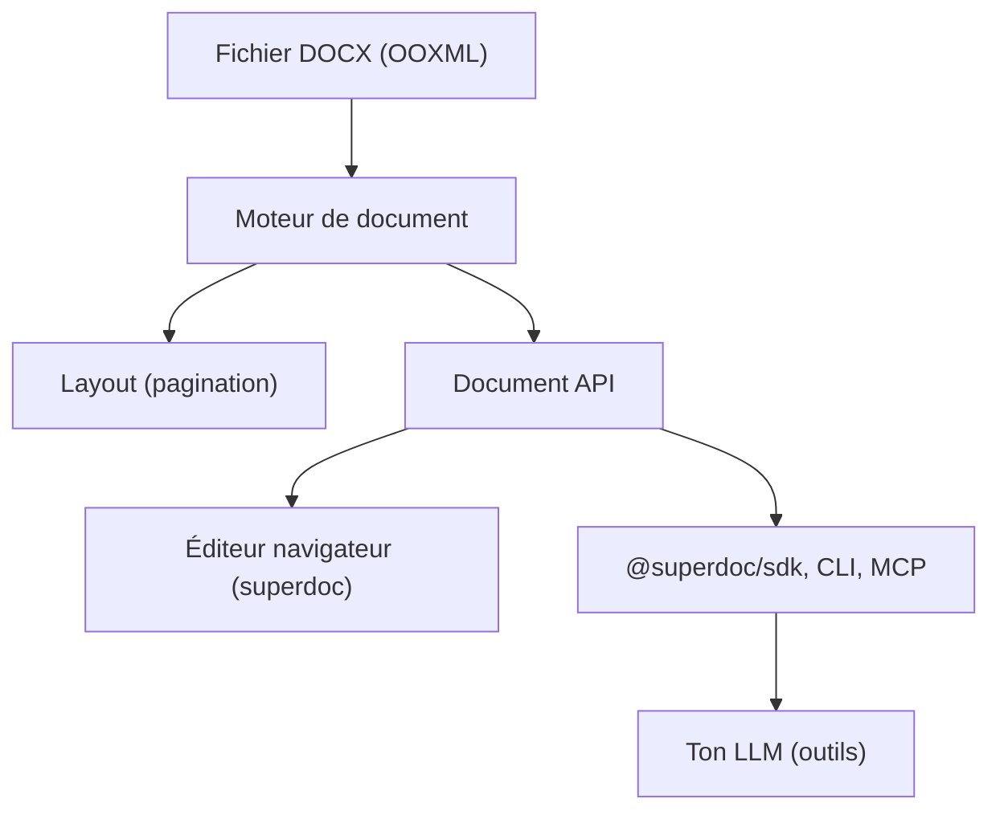

# superdoc-dev/superdoc

> Open source DOCX editor and agent SDK for reviewing, filling in and editing Word documents.

## The problem
Editing DOCX by code or by an agent often goes through an HTML conversion that loses tracked changes, comments and layout.

## What it actually does
Reads, displays and rewrites the OOXML parts of a DOCX without HTML conversion. Provides a browser editor, React and Vue wrappers, a Node, Python and Rust SDK, a CLI and an MCP server. A toolkit lets an LLM edit a document, with the changes recorded as revisions. The engine runs on your side: content is not sent to SuperDoc.

## How it is wired


## Trying it
```bash
npm install superdoc
npm install @superdoc/sdk ai@6 @ai-sdk/anthropic@3
curl -fL https://raw.githubusercontent.com/superdoc/docx-editor/refs/heads/main/assets/sample-contract.docx -o sample-contract.docx
```

## Cost and gotchas
AGPL-3.0 license with a commercial license for proprietary deployments. The agent example requires `ANTHROPIC_API_KEY`: the content sent to the model follows the provider's policy.

## What it is not
Not a simple DOCX converter: it is a full editing engine. The AGPL requires sharing the code of services that embed it, unless you buy a license.

## Alternatives
No alternative named in the README.

## For you
Worth watching: very relevant for agents that edit contracts as tracked revisions, but the AGPL must be validated before any product use.
