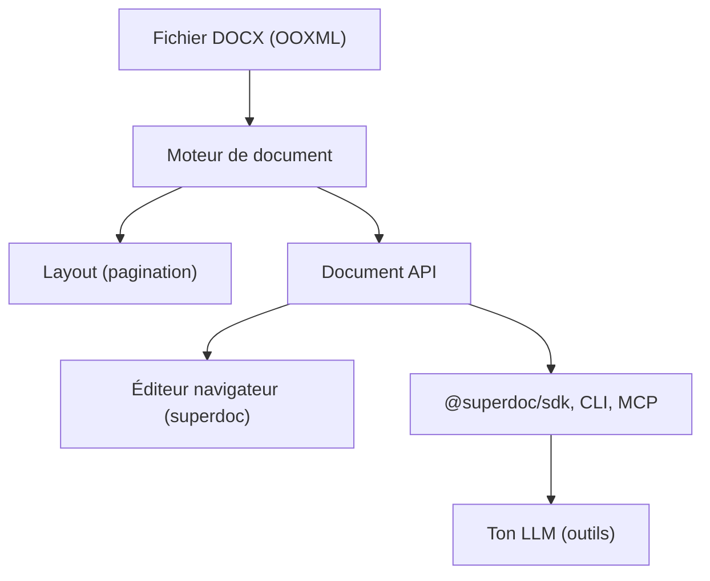

# superdoc-dev/superdoc

> Éditeur DOCX open source et SDK d'agents pour relire, remplir et modifier des documents Word.

## Le problème
Éditer du DOCX par code ou par un agent passe souvent par une conversion HTML qui perd suivi des modifications, commentaires et mise en page.

## Ce que ça fait vraiment
Lit, affiche et réécrit les parties OOXML d'un DOCX sans conversion HTML. Fournit un éditeur navigateur, des wrappers React et Vue, un SDK Node, Python et Rust, une CLI et un serveur MCP. Un kit d'outils permet à un LLM de modifier un document, avec les changements enregistrés en révisions. Le moteur tourne chez toi : le contenu n'est pas envoyé à SuperDoc.

## Comment c'est branché


## Essayer
```bash
npm install superdoc
npm install @superdoc/sdk ai@6 @ai-sdk/anthropic@3
curl -fL https://raw.githubusercontent.com/superdoc/docx-editor/refs/heads/main/assets/sample-contract.docx -o sample-contract.docx
```

## Coût et pièges
Licence AGPL-3.0 avec licence commerciale pour les déploiements propriétaires. L'exemple agent demande `ANTHROPIC_API_KEY` : le contenu envoyé au modèle suit la politique du fournisseur.

## Ce que ce n'est pas
Pas un simple convertisseur DOCX : c'est un moteur d'édition complet. L'AGPL impose le partage du code des services qui l'embarquent, sauf achat de licence.

## Alternatives
Aucune alternative nommée dans le README.

## Pour toi
À surveiller : très pertinent pour des agents qui éditent des contrats en révisions, mais l'AGPL est à valider avant tout usage produit.

