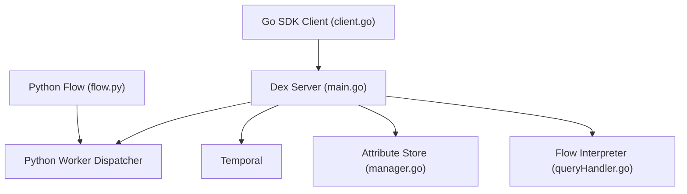

# superdurable/dex

> Durable execution framework built on Temporal, designed for AI agents and human+AI processes.

## The problem
A long workflow (agents, event waits, timers) must survive crashes and restarts without rewriting the recovery logic by hand.

## What it actually does
You write a Flow in ordinary code with durable Steps, Attributes, RPCs, Channels and Timers; Workers host it, a Client starts the instances, the Dex Server dispatches the tasks. It adds in-memory streaming, attribute storage and offloading of large payloads to blob storage. Go, Python, TypeScript and Java SDKs; CLI and web interface. The README announces a beta.

## How it is wired

## Trying it
No command in the README; it points to the Quick start on docs.superdurable.io.

## Cost and gotchas
Free, but relies on Temporal, which you must host; installation is not documented here. Beta: the API may get minor changes.

## What it is not
Not an LLM agent framework: it is a durable orchestration layer. Not a replacement for Temporal, which it extends.

## Alternatives
Temporal, cited as the reference platform Dex starts from.

## For you
Keep an eye on it: useful for long, reliable pipelines/agents, but beta, license not identified and dependent on Temporal.
