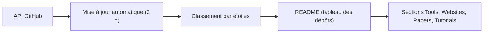

# superiorlu/AITreasureBox

> List of AI repositories, tools, websites, papers and tutorials, automatically ranked by stars.

## The problem
The flow of AI projects is too broad to follow by hand, and static lists age quickly.

## What it actually does
The README is a ranking of GitHub repositories updated every two hours, with number, name and description. It covers popular projects (n8n, ollama, transformers, llama.cpp, vLLM, Claude Code, LangChain) and 🔥 and ⭐ markers on some. Sections point to tools, websites, articles and tutorials. The text provided is truncated at rank 189.

## How it is wired
Simplified diagram based on the sheet, no diagram provided.

## Trying it
No command documented: you read the README online.

## Cost and gotchas
Free. The ranking follows popularity, not quality, and includes general-purpose lists unrelated to AI (`public-apis`, `awesome`). The license is GPL-3.0 according to the catalog.

## What it is not
It is not an editorially curated or verified selection: it is a sort by stars. The descriptions come from GitHub, not from an evaluation.

## Alternatives
No alternative named in the README.

## For you
Worth watching: handy as a popularity radar, but your own filtered watch is better than a raw ranking, and you have to do the sorting yourself.
