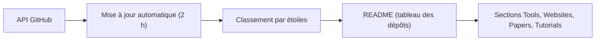

# superiorlu/AITreasureBox

> Liste de dépôts, outils, sites, papiers et tutoriels IA, classée automatiquement par étoiles.

## Le problème
Le flux de projets IA est trop large pour être suivi à la main, et les listes statiques vieillissent vite.

## Ce que ça fait vraiment
Le README est un classement de dépôts GitHub mis à jour toutes les deux heures, avec numéro, nom et description. Il couvre des projets populaires (n8n, ollama, transformers, llama.cpp, vLLM, Claude Code, LangChain) et des marqueurs 🔥 et ⭐ sur certains. Des sections renvoient à des outils, sites, articles et tutoriels. Le texte fourni est tronqué au rang 189.

## Comment c'est branché
Schéma simplifié d'après la fiche, sans diagramme fourni.

## Essayer
Aucune commande documentée : on lit le README en ligne.

## Coût et pièges
Gratuit. Le classement suit la popularité, pas la qualité, et inclut des listes généralistes sans rapport avec l'IA (`public-apis`, `awesome`). La licence est GPL-3.0 d'après le catalogue.

## Ce que ce n'est pas
Ce n'est pas une sélection éditorialisée ni vérifiée : c'est un tri par étoiles. Les descriptions viennent de GitHub, pas d'une évaluation.

## Alternatives
Aucune alternative nommée dans le README.

## Pour toi
À surveiller : pratique comme radar de popularité, mais ta propre veille filtrée vaut mieux qu'un classement brut, et il faut trier soi-même.

