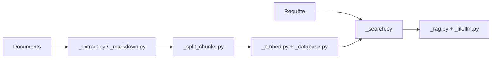

# superlinear-ai/raglite

> Python toolkit for RAG on DuckDB or PostgreSQL, without PyTorch or LangChain.

## The problem
Building a decent RAG (PDF, chunking, hybrid search, reranking) involves assembling many heavy building blocks.

## What it actually does
Converts documents to Markdown, splits them with integer programming (sentences and semantic chunks), embeds with multi-vector late chunking, searches in hybrid mode (FTS + vectors) then reranks (FlashRank by default). Adaptive RAG where the LLM decides whether to retrieve, query adapter, Ragas evaluation, MCP server and Chainlit front end. LLM via LiteLLM or llama-cpp-python locally.

## How it is wired


## Trying it
```bash
pip install raglite
pip install raglite[chainlit]
raglite --db-url duckdb:///raglite.db --llm gpt-4o-mini --embedder text-embedding-3-large chainlit
```
The README details the `RAGLiteConfig` configuration and `insert_documents`.

## Cost and gotchas
With a remote LLM, API key at your expense; locally, GGUF weights to download, an accelerated llama-cpp-python binary recommended. PostgreSQL possible via a third-party service.

## What it is not
Not a turnkey RAG platform nor a managed service. MPL-2.0 license: weak copyleft on modified files.

## Alternatives
The README cites LiteLLM and rerankers as building blocks, not as competitors.

## For you
Worth adopting for a light, local RAG prototype: lean dependencies, hybrid search and evaluation included.
