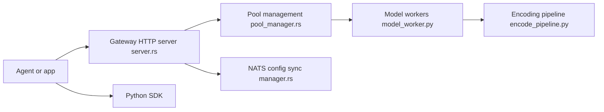

# superlinked/sie

> Self-hosted inference engine serving more than 100 models (embeddings, OCR, extraction, generation) through a single API.

## The problem
Each task of an agent (search, OCR, extraction, guardrails, translation) tends to have its own model server.

## What it actually does
A server loads models on demand with LRU eviction and exposes an OpenAI-compatible API (`/v1/embeddings`, `/v1/chat/completions`, `/v1/responses`). A catalog covers search (bge-m3, SPLADE, ColBERT), document to Markdown, structured output, guardrails, translation, vision, transcription. Python and TypeScript SDKs, LangChain, LlamaIndex, Haystack, Qdrant, Weaviate... integrations, Kubernetes/Helm gateway with KEDA.

## How it is wired


## Trying it
```bash
pip install "sie-server[local]" && sie-server serve
docker run --gpus all -p 8080:8080 -v sie-hf-cache:/app/.cache/huggingface ghcr.io/superlinked/sie-server:latest-cuda12-default
curl http://localhost:8080/readyz
pip install sie-sdk
```

## Cost and gotchas
Docker images are per model bundle (CUDA, CPU, SGLang...). Python 3.12 natively. First call to a model = download of the weights. Anonymous telemetry, can be disabled (`SIE_TELEMETRY_DISABLED=1`).

## What it is not
Not a managed host: you operate the GPU and the cluster yourself. Performance is not quantified in the README.

## Alternatives
No alternative named in the README.

## For you
To adopt for consolidating your embedding and reranking models behind a single API; Apache 2.0 and Kubernetes deployment ready.
