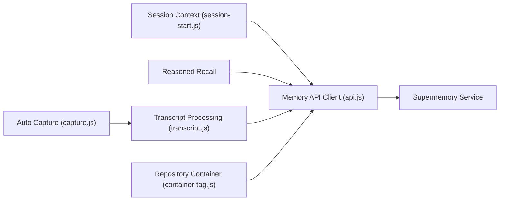

# supermemoryai/claude-supermemory

> Claude Code plugin that gives sessions persistent memory through the Supermemory service.

## The problem
Claude Code forgets everything from one session to the next and from one project to another.

## What it actually does
Node hooks load a memory profile at startup, decide before each turn whether a recall is useful, and capture the conversation at the end of the session. Memories are stored in one container per repository (derived from the git remote), shared with Codex and OpenCode; a team memory is separate from personal memories. Commands: `index`, `project-config`, `status`, `session`, `logout`.

## How it is wired


## Trying it
```bash
/plugin marketplace add supermemoryai/claude-supermemory
/plugin install supermemory
export SUPERMEMORY_CC_API_KEY="sm_..."
```

## Cost and gotchas
Supermemory API key (console.supermemory.ai); conversations are sent to their service. The README refers to the privacy policy for retention.

## What it is not
Not local storage: without the Supermemory service, nothing works. No license declared in the catalog.

## Alternatives
No alternative named in the README.

## For you
Worth watching: handy, but your code sessions go to a third party and the license is missing; prefer a local memory if your repositories are sensitive.
