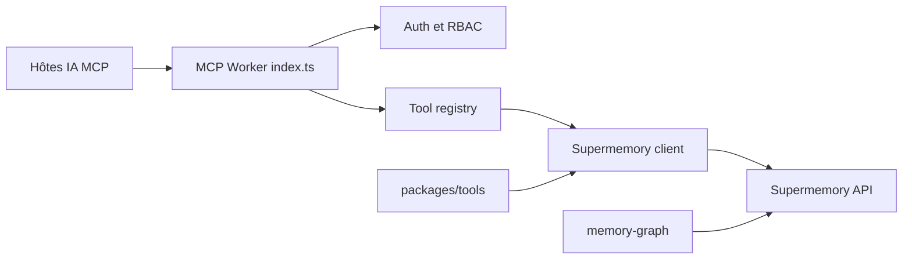

# supermemoryai/supermemory

> Memory layer for AI assistants: retains a user's facts and preferences from one conversation to the next.

## The problem
An AI assistant forgets everything between two conversations. Without a dedicated layer, you have to hack together vector storage, embeddings and chunking yourself.

## What it actually does
An API (`add`, `profile`, `search`) extracts facts from conversations, maintains a per-user profile (stable facts + recent context) and does a mixed document + memory search. The repository mostly contains the clients: MCP server (Cloudflare Worker), wrappers for the Vercel AI SDK, OpenAI, Mastra, Python integrations, a React graph. The engine itself is an external service, hosted or local.

## How it is wired


## Trying it
```bash
npm install supermemory    # or: pip install supermemory
curl -fsSL https://supermemory.ai/install | bash
supermemory-server
```

## Cost and gotchas
The hosted plan goes through the Supermemory API; local mode requires an LLM provider key (or Ollama). The README mentions `SUPERMEMORY_DISABLE_TELEMETRY=1`: telemetry therefore exists by default. URL ingestion goes through a hosted reading service.

## What it is not
It is not the open engine: the engine code is not in this repository. The "#1" rankings on benchmarks are the vendor's figures, not verified here. It is not a simple RAG.

## Alternatives
- Mem0: compared in MemoryBench, as a direct competitor.
- Zep: likewise, another memory provider.

## For you
Watch: the API is simple and a local mode exists, but the engine remains closed and telemetry is on by default; test on a small agent before depending on it.
