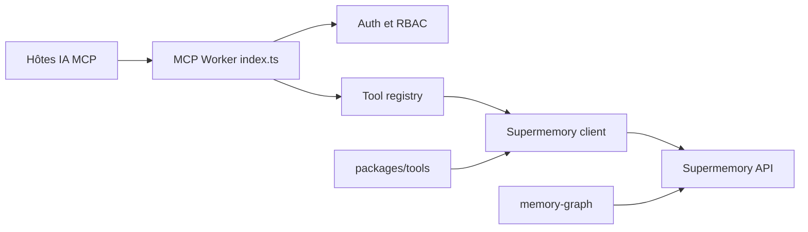

# supermemoryai/supermemory

> Couche de mémoire pour assistants IA : retient faits et préférences d'un utilisateur d'une conversation à l'autre.

## Le problème
Un assistant IA oublie tout entre deux conversations. Sans couche dédiée, il faut bricoler stockage vectoriel, embeddings et découpage soi-même.

## Ce que ça fait vraiment
Une API (`add`, `profile`, `search`) extrait des faits des conversations, tient un profil par utilisateur (faits stables + contexte récent) et fait une recherche mixte documents + mémoire. Le dépôt contient surtout les clients : serveur MCP (Cloudflare Worker), wrappers pour Vercel AI SDK, OpenAI, Mastra, intégrations Python, graphe React. Le moteur lui-même est un service externe, hébergé ou local.

## Comment c'est branché


## Essayer
```bash
npm install supermemory    # or: pip install supermemory
curl -fsSL https://supermemory.ai/install | bash
supermemory-server
```

## Coût et pièges
Le plan hébergé passe par l'API Supermemory ; le mode local demande une clé de fournisseur LLM (ou Ollama). Le README mentionne `SUPERMEMORY_DISABLE_TELEMETRY=1` : de la télémétrie existe donc par défaut. L'ingestion d'URL passe par un service de lecture hébergé.

## Ce que ce n'est pas
Ce n'est pas le moteur ouvert : le code du moteur n'est pas dans ce dépôt. Les classements « #1 » sur les benchmarks sont des chiffres de l'éditeur, non vérifiés ici. Ce n'est pas un simple RAG.

## Alternatives
- Mem0 : comparé dans MemoryBench, pour un concurrent direct.
- Zep : idem, autre fournisseur de mémoire.

## Pour toi
À surveiller : l'API est simple et le mode local existe, mais le moteur reste fermé et la télémétrie est active par défaut ; teste sur un petit agent avant d'en dépendre.

