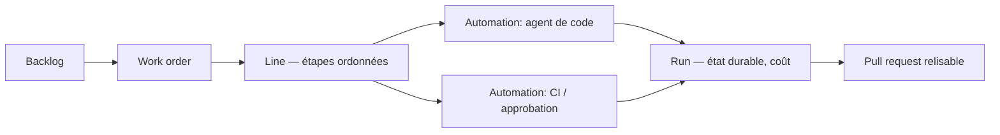

# superplanehq/superplane

> Engine that has agents process backlog tickets deemed safe, all the way to the PR.

## The problem
Delegating a task to a coding agent forces you to manage the sequencing yourself: branching, running CI, reviewing, approving, sending the failure back to the agent with enough context for it to fix it.

## What it actually does
The vocabulary is that of a factory. A **Factory** holds a team's work orders, automation lines and policies. A **work order** traces a delegated task from input to final result. A **line** defines the ordered steps; an **automation** launches an agent, calls a tool, waits for an event or requires an approval; a **run** records the durable execution, inputs, outputs, retries and cost. The system continuously assesses which tickets agents can handle with confidence and sends failures back to the agent.

## How it is wired


## Trying it
```bash
# Aucune commande documentée dans le README : il décrit le modèle de ressources
# et renvoie à la page des intégrations.
```

## Cost and gotchas
Engine under Apache 2.0, but the README does not say what remains outside the engine nor how it is deployed — no installation, no configuration. The agents consume billed models (Claude, Cursor, OpenAI, OpenRouter, Perplexity): the cost per run is tracked, not eliminated. Each cited integration assumes a third-party account.

## What it is not
It is not a coding agent: it coordinates the ones you choose. It is not meant for ambiguous work — the README explicitly reserves judgment decisions for humans.
No measurable evidence on the quality of the PRs produced.

## Alternatives
No alternative named in the README.

## For you
An interesting idea to follow, but with no deployment instructions, there is nothing to try today.
