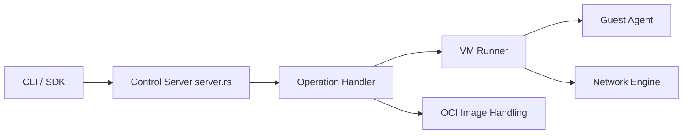

# superradcompany/microsandbox

> Runs untrusted code in local microVMs, for AI agents, CI and scripts.

## The problem
Running LLM-generated or plugin code on your own machine is risky, and a container shares the host kernel.

## What it actually does
Launches local microVMs from OCI images (Docker Hub, GHCR) with hardware isolation. An `msb` CLI creates, runs, forks and snapshots sandboxes; SDKs (TypeScript, Rust, Python, Go, Ruby) drive them from code, with no daemon. Secrets are injected without entering the VM, and an MCP server is provided.

## How it is wired


## Trying it
```bash
curl -fsSL https://install.microsandbox.dev | sh
msb run ubuntu
msb run python -- python3 -c "print('Hello from a microVM!')"
npm i microsandbox
```

## Cost and gotchas
Free. Hardware prerequisites: Apple Silicon on macOS, KVM on Linux, WHP on Windows. The README warns that this is a beta version with possible breaking changes.

## What it is not
Not a hosted service: everything runs locally. The sub-100 ms startup figures are given by the author.

## Alternatives
- pydantic/monty: lighter Python sandbox, without a VM (not named here, see dedicated sheet).

## For you
Keep an eye on it: very relevant for isolating agent code, but the beta status and the virtualization prerequisite justify waiting for a stable version.
