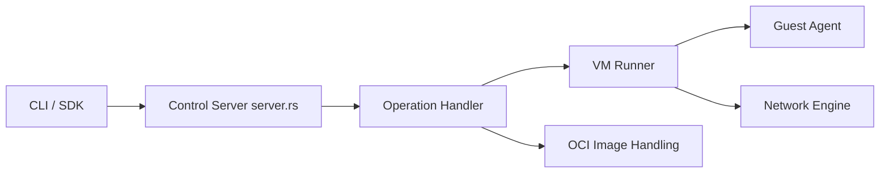

# superradcompany/microsandbox

> Exécute du code non fiable dans des microVM locales, pour agents IA, CI et scripts.

## Le problème
Faire tourner du code généré par un LLM ou un plugin sur sa machine est risqué, et un conteneur partage le noyau de l'hôte.

## Ce que ça fait vraiment
Lance des microVM locales à partir d'images OCI (Docker Hub, GHCR) avec isolation matérielle. Une CLI `msb` crée, exécute, fork et snapshotte des sandbox ; des SDK (TypeScript, Rust, Python, Go, Ruby) les pilotent depuis le code, sans démon. Les secrets sont injectés sans entrer dans la VM, et un serveur MCP est fourni.

## Comment c'est branché


## Essayer
```bash
curl -fsSL https://install.microsandbox.dev | sh
msb run ubuntu
msb run python -- python3 -c "print('Hello from a microVM!')"
npm i microsandbox
```

## Coût et pièges
Gratuit. Prérequis matériels : Apple Silicon sur macOS, KVM sur Linux, WHP sur Windows. Le README avertit que c'est une version bêta avec changements cassants possibles.

## Ce que ce n'est pas
Pas un service hébergé : tout tourne en local. Les mesures de démarrage sous 100 ms sont données par l'auteur.

## Alternatives
- pydantic/monty : sandbox Python plus légère, sans VM (non nommé ici, voir fiche dédiée).

## Pour toi
À surveiller : très pertinent pour isoler du code d'agent, mais la bêta et le prérequis de virtualisation justifient d'attendre une version stable.

