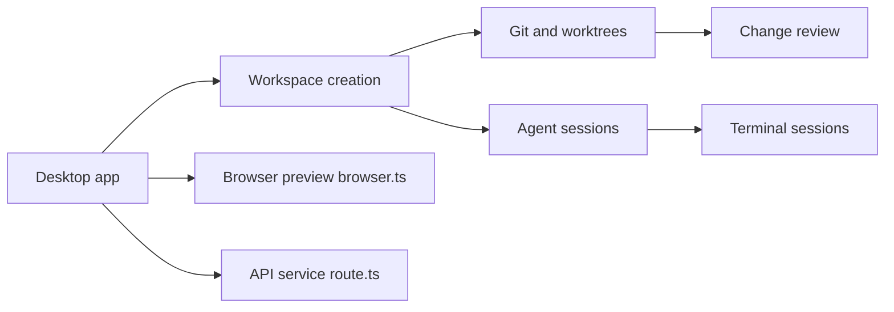

# superset-sh/superset

> Desktop application that runs several coding agents in parallel, each in its own git worktree.

## The problem
Driving several CLI agents in parallel means juggling terminals, branches and previews.

## What it actually does
Creates one workspace per task (git worktree, branch, terminals), launches the chosen agent (Claude Code, Codex…), shows diffs, comments and a built-in browser with per-workspace ports. Adds scheduled automations, remote access, a CLI, a TypeScript SDK and an MCP server. iOS mobile is reserved for the Pro plan.

## How it is wired


## Trying it
```bash
curl -fsSL https://superset.sh/cli/install.sh | sh
# ou
brew install superset-sh/tap/superset
# développement
./.superset/setup.local.sh
bun run dev
```

## Cost and gotchas
macOS is the main platform, Linux is experimental, Windows is absent. Mobile requires Superset Pro and iOS 26. Building from source requires Bun, Docker, jq and gh.

## What it is not
Worktrees are not a sandbox: no process isolation and no merge-conflict prevention. A license is present but not identified by GitHub: read it before any professional use.

## Alternatives
- max-sixty/worktrunk: CLI only for worktrees, lighter.

## For you
Worth watching: handy if you orchestrate many agents on macOS, but the unclear license and the paid plans call for a check.
