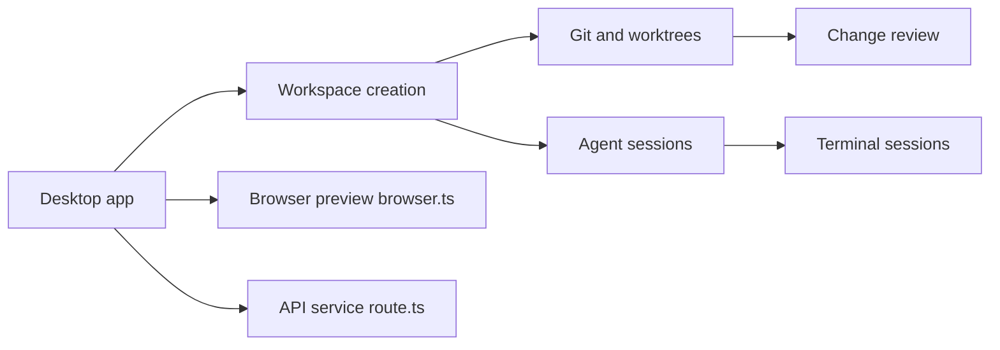

# superset-sh/superset

> Application de bureau qui lance plusieurs agents de code en parallèle, chacun dans son worktree git.

## Le problème
Piloter plusieurs agents CLI en parallèle impose de jongler entre terminaux, branches et prévisualisations.

## Ce que ça fait vraiment
Crée un workspace par tâche (worktree git, branche, terminaux), lance l'agent choisi (Claude Code, Codex…), affiche diff, commentaires et navigateur intégré avec ports par workspace. Ajoute automatisations planifiées, accès distant, CLI, SDK TypeScript et serveur MCP. Mobile iOS réservé à l'offre Pro.

## Comment c'est branché


## Essayer
```bash
curl -fsSL https://superset.sh/cli/install.sh | sh
# ou
brew install superset-sh/tap/superset
# développement
./.superset/setup.local.sh
bun run dev
```

## Coût et pièges
macOS principal, Linux expérimental, Windows absent. Le mobile exige Superset Pro et iOS 26. Compiler depuis les sources demande Bun, Docker, jq et gh.

## Ce que ce n'est pas
Les worktrees ne sont pas un bac à sable : pas d'isolation des processus ni anti-conflits de fusion. Licence présente mais non identifiée par GitHub : à lire avant tout usage pro.

## Alternatives
- max-sixty/worktrunk : CLI seule pour les worktrees, plus léger.

## Pour toi
À surveiller : pratique si tu orchestres beaucoup d'agents sur macOS, mais la licence floue et les offres payantes appellent une vérification.

