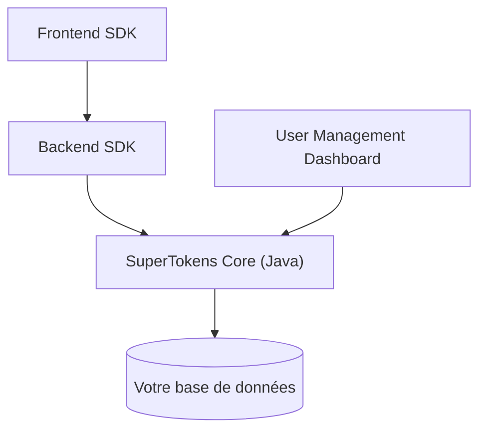

# supertokens/supertokens-core

> Open-core, self-hostable authentication service, to add login and sessions to your applications.

## The problem
Writing your own authentication is risky and time-consuming. Offerings like Auth0 or AWS Cognito lock users in.

## What it actually does
A Java HTTP service (the "Core") handles the authentication logic and the database. A backend SDK (Node.js, Go, Python) exposes the sign-up, login and session routes; a frontend SDK (React, React Native…) handles tokens and the interface. Features: passwordless login, social, email, multi-factor, roles, multi-tenant.

## How it is wired

## Trying it
No command documented in the README: build instructions are in the wiki and the documentation.

## Cost and gotchas
Free "with no user limit", but the model is open-core: some features (enterprise SSO) may be paid, not detailed here. You host the Core and the database. A license is present but not identified: read it before use.

## What it is not
It is not an embedded library: you must deploy the Core service. The Core is not what you usually modify; API changes go through the SDKs.

## Alternatives
- Auth0 and AWS Cognito: the README cites them as the proprietary solutions SuperTokens replaces.

## For you
Worth watching: useful to secure a self-hosted application or model API, but to be validated after reading the license.
