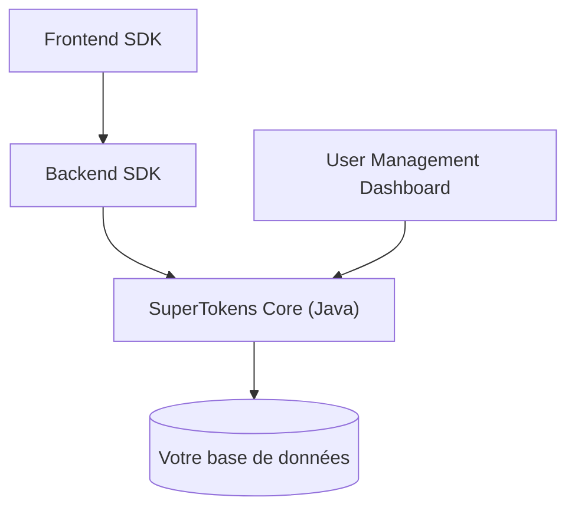

# supertokens/supertokens-core

> Service d'authentification open-core, auto-hébergeable, pour ajouter connexion et sessions à ses applications.

## Le problème
Écrire sa propre authentification est risqué et chronophage. Les offres comme Auth0 ou AWS Cognito enferment les utilisateurs.

## Ce que ça fait vraiment
Un service HTTP en Java (le « Core ») gère la logique d'authentification et la base de données. Un SDK backend (Node.js, Go, Python) expose les routes d'inscription, de connexion et de session ; un SDK frontend (React, React Native…) gère les jetons et l'interface. Fonctions : connexion sans mot de passe, sociale, e-mail, multi-facteurs, rôles, multi-tenant.

## Comment c'est branché

## Essayer
Aucune commande documentée dans le README : les instructions de build sont dans le wiki et la documentation.

## Coût et pièges
Gratuit « sans limite d'utilisateurs », mais le modèle est open-core : certaines fonctions (SSO entreprise) peuvent être payantes, non détaillé ici. Tu héberges le Core et la base. Licence présente mais non identifiée : à lire avant usage.

## Ce que ce n'est pas
Ce n'est pas une bibliothèque embarquée : il faut déployer le service Core. Le Core n'est pas ce qu'on modifie d'ordinaire, les changements d'API passent par les SDK.

## Alternatives
- Auth0 et AWS Cognito : le README les cite comme solutions propriétaires que SuperTokens remplace.

## Pour toi
À surveiller : utile pour sécuriser une application ou une API de modèle auto-hébergée, mais à valider après lecture de la licence.

