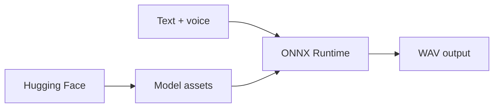

# supertone-inc/supertonic

> 99M-parameter local text-to-speech via ONNX Runtime, 31 languages, no GPU or cloud.

## The problem
Text-to-speech APIs send the text to a third party and bill per use.

## What it actually does
ONNX weights (~99M parameters) and examples in eleven environments: Python, Node, browser, Java, C++, C#, Go, Swift, iOS, Rust, Flutter. 44.1 kHz WAV output, 10 expression tags. No voice cloning in the open version.

## How it is wired


## Trying it
```bash
git clone https://github.com/supertone-oss-archive/supertonic.git
cd supertonic
python3.11 -m venv .venv
source .venv/bin/activate
python -m pip install huggingface_hub
hf download supertone-oss-archive/supertonic-3 --revision aafc6e32416a594460b32413efc49d7fe4ce6d46 --local-dir assets
python -m pip install -r py/requirements.txt
cd py
python example_onnx.py --n-test 1 --text "Hello" --lang en
```

## Cost and gotchas
Free, weights download (Hugging Face archive). The repo is archived: no updates or security fixes.

## What it is not
Not a maintained service: Voice Builder closed at the end of August 2026. Anomaly: the catalog says "archived: no" while the README announces the archiving. The license of the code and of the weights is not specified.

## Alternatives
The README table compares with VoxCPM2, OmniVoice and Qwen3-TTS (WER/CER).

## For you
Worth watching: fine for trying local speech synthesis without a GPU, but with no support or evolution, so not to be put at the core of a product.
