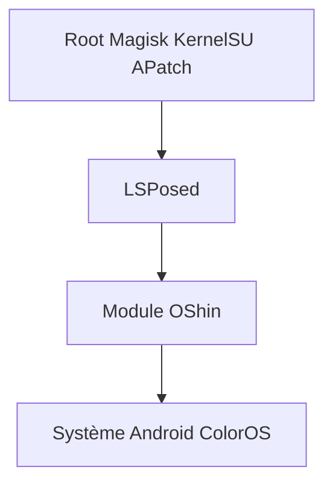

# suqi8/OShin

> Xposed module to customize ColorOS, RealmeUI and OxygenOS 16 on rooted Android.

## The problem
ColorOS settings do not allow some tweaks that advanced users look for.

## What it actually does
An LSPosed module that targets the system framework to change ColorOS 16 behavior. The README details no feature: it points to online documentation. Since November 12, 2025, the main repository is private and this repository is only a reference mirror.

## How it is wired
Simplified diagram based on the fiche, no diagram provided.

## Trying it
No command in the README. Steps described: install the module via LSPosed, tick the system scope (system, android), then reboot.

## Cost and gotchas
Free, but root and LSPosed are required. The README forbids removing the Umeng SDK and the mainland China launch check.

## What it is not
Not an open project: the up-to-date code is no longer public. Not a consumer app that works without root. Thin README material.

## Alternatives
No alternative named in the README.

## For you
Ignore: an Android customization module unrelated to data or AI, with recent code closed and a mandatory measurement SDK.
