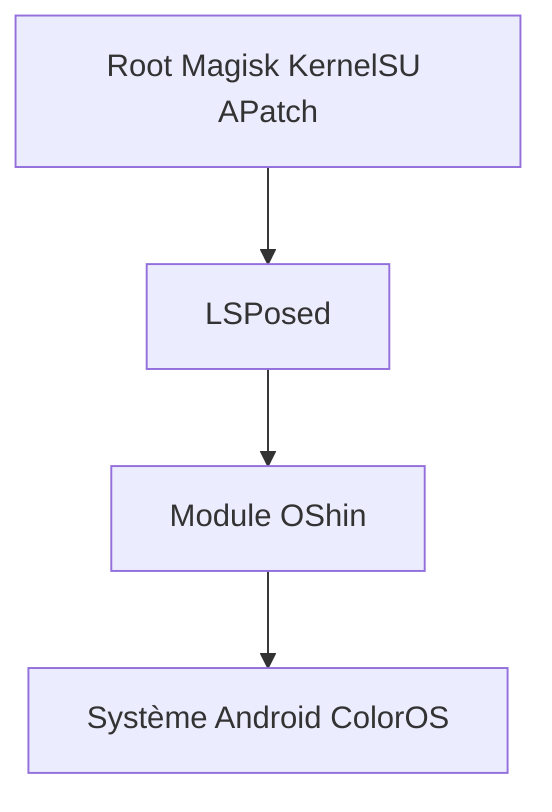

# suqi8/OShin

> Module Xposed pour personnaliser ColorOS, RealmeUI et OxygenOS 16 sur Android rooté.

## Le problème
Les réglages de ColorOS ne permettent pas certains ajustements que cherchent les utilisateurs avancés.

## Ce que ça fait vraiment
Un module LSPosed qui cible le framework système pour modifier le comportement de ColorOS 16. Le README ne détaille aucune fonction : il renvoie à une documentation en ligne. Depuis le 12 novembre 2025, le dépôt principal est privé et ce dépôt n'est qu'un miroir de référence.

## Comment c'est branché
Schéma simplifié d'après la fiche, sans diagramme fourni.

## Essayer
Aucune commande dans le README. Étapes décrites : installer le module via LSPosed, cocher le scope système (system, android), puis redémarrer.

## Coût et pièges
Gratuit, mais Root et LSPosed sont requis. Le README interdit de retirer le SDK Umeng et la vérification de lancement en Chine continentale.

## Ce que ce n'est pas
Pas un projet ouvert : le code à jour n'est plus public. Pas une appli grand public sans root. Matière du README maigre.

## Alternatives
Aucune alternative nommée dans le README.

## Pour toi
À ignorer : module de personnalisation Android sans rapport avec la data ou l'IA, au code récent fermé et avec un SDK de mesure imposé.

