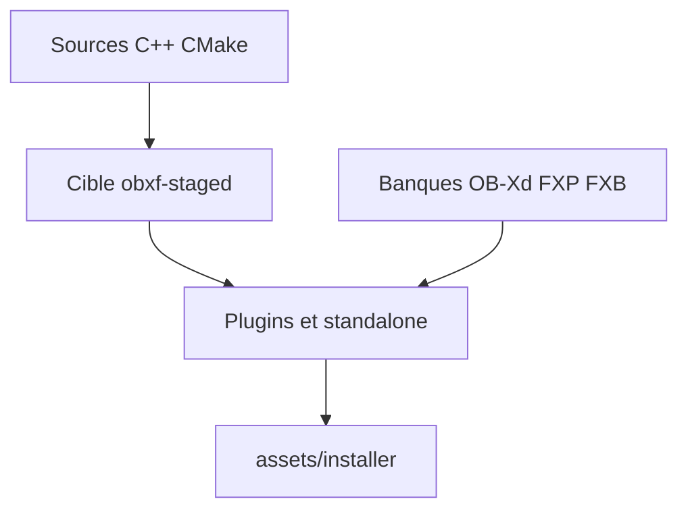

# surge-synthesizer/OB-Xf

> Free software synthesizer as an audio plugin, successor to OB-Xd, for musicians and producers.

## The problem
OB-Xd was no longer maintained as open source. Existing patches and banks risked being left without a successor.

## What it actually does
Synthesis plugin and standalone application, in beta but stable according to the authors. It imports OB-Xd's FXP/FXB banks, fixes the 12-semitone offset in the reference pitch and offers macOS, Windows and Linux installers. An iPad target is in progress, compilation only.

## How it is wired
Simplified diagram based on the note, no diagram provided.



## Trying it
```bash
git submodule update --init --recursive
cmake -B Builds/Release -DCMAKE_BUILD_TYPE=Release .
cmake --build Builds/Release --config Release --target obxf-staged
cmake --install Builds/Release
```

## Cost and gotchas
Free. Home build: install the assets yourself. No iOS build distributed because of the GPLv3 (personal compilation only).

## What it is not
It is not a development or data tool. The iOS port is incomplete. Importing from OB-Xd may sound an octave lower in an edge case.

## Alternatives
No alternative named in the README, apart from OB-Xd, of which it is the successor.

## For you
Ignore for your data/AI/MLOps profile: it is a musical instrument, unrelated to your work.
