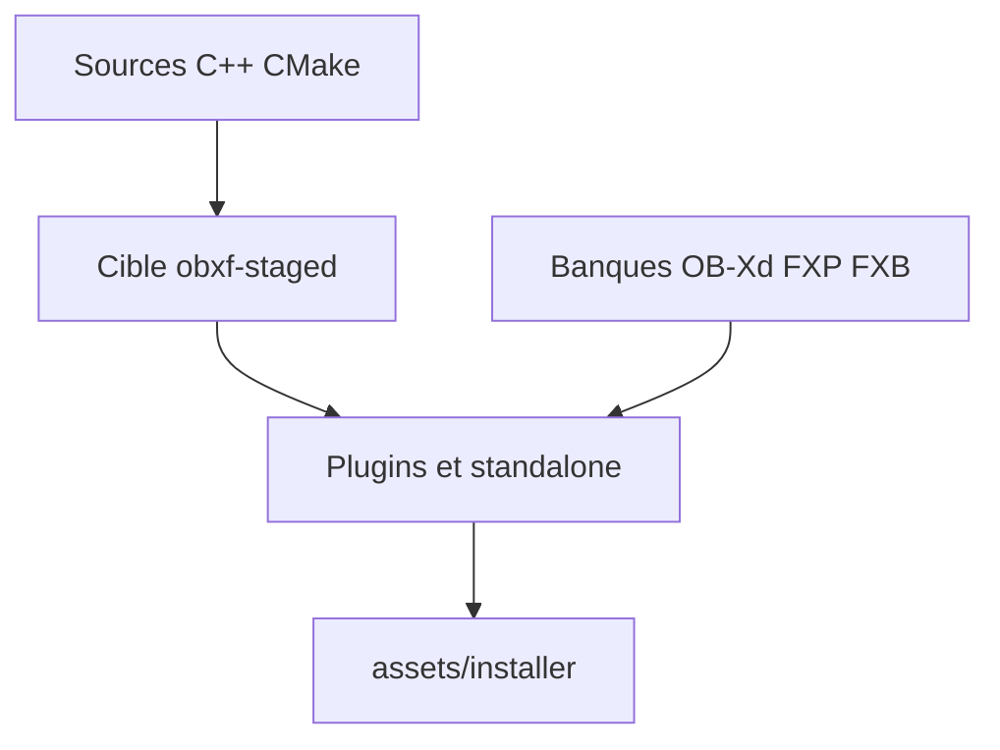

# surge-synthesizer/OB-Xf

> Synthétiseur logiciel libre en plugin audio, suite d'OB-Xd, pour musiciens et producteurs.

## Le problème
OB-Xd n'était plus maintenu en open source. Les patchs et banques existants risquaient de rester sans successeur.

## Ce que ça fait vraiment
Plugin et application autonome de synthèse, en bêta mais stable selon les auteurs. Il importe les banques FXP/FXB d'OB-Xd, corrige le décalage de 12 demi-tons de la hauteur de référence et propose des installeurs macOS, Windows et Linux. Une cible iPad est en cours, en compilation seulement.

## Comment c'est branché
Schéma simplifié d'après la fiche, sans diagramme fourni.



## Essayer
```bash
git submodule update --init --recursive
cmake -B Builds/Release -DCMAKE_BUILD_TYPE=Release .
cmake --build Builds/Release --config Release --target obxf-staged
cmake --install Builds/Release
```

## Coût et pièges
Gratuit. Compilation maison : installer soi-même les assets. Pas de build iOS distribué à cause de la GPLv3 (compilation personnelle uniquement).

## Ce que ce n'est pas
Ce n'est pas un outil de développement ni de données. Le portage iOS est incomplet. L'import d'OB-Xd peut sonner une octave plus bas dans un cas limite.

## Alternatives
Aucune alternative nommée dans le README, hormis OB-Xd dont il est la suite.

## Pour toi
À ignorer pour ton profil data/IA/MLOps : c'est un instrument de musique, sans lien avec ton métier.

