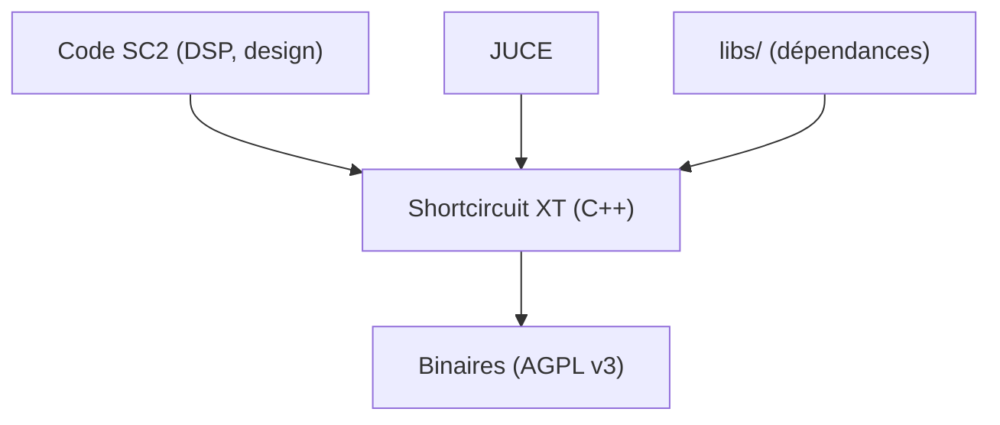

# surge-synthesizer/shortcircuit-xt

> Audio sampler in C++ and JUCE, successor to Shortcircuit, for musicians and audio developers.

## The problem
A historic creative sampler was no longer maintained nor available on modern systems.

## What it actually does
Rebuilds the Shortcircuit sampler in modern C++ and JUCE, keeping much of the original design and DSP. The beta version is downloadable; many things remain incomplete.

## How it is wired
Simplified diagram based on the sheet, no diagram provided.


## Trying it
```bash
git clone <this repo or your fork>
cd shortcircuit-xt
git submodule update --init --recursive
cmake -Bignore/build -DCMAKE_BUILD_TYPE=Release
cmake --build ignore/build --config Release --target shortcircuit-products
```

## Cost and gotchas
C++ build with CMake and submodules; on Linux, the dependencies are in the CI Dockerfile. Binaries are distributed under AGPL v3 despite MIT-licensed code.

## What it is not
Not a finished product: the README mentions a beta and missing features. Not related to data or AI.

## Alternatives
None named in the README.

## For you
Ignore: an audio tool unrelated to your data / AI / MLOps work.
