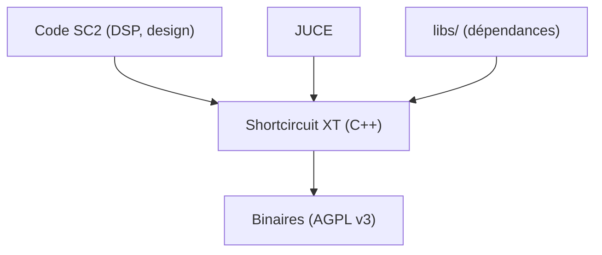

# surge-synthesizer/shortcircuit-xt

> Échantillonneur audio en C++ et JUCE, successeur de Shortcircuit, pour musiciens et développeurs audio.

## Le problème
Un échantillonneur créatif historique n'était plus maintenu ni disponible sur les systèmes modernes.

## Ce que ça fait vraiment
Reconstruit l'échantillonneur Shortcircuit en C++ moderne et JUCE, en gardant une grande part du design et du DSP d'origine. La version beta est téléchargeable ; beaucoup de choses restent incomplètes.

## Comment c'est branché
Schéma simplifié d'après la fiche, sans diagramme fourni.


## Essayer
```bash
git clone <this repo or your fork>
cd shortcircuit-xt
git submodule update --init --recursive
cmake -Bignore/build -DCMAKE_BUILD_TYPE=Release
cmake --build ignore/build --config Release --target shortcircuit-products
```

## Coût et pièges
Compilation C++ avec CMake et sous-modules ; sous Linux, les dépendances sont dans le Dockerfile de CI. Binaires distribués sous AGPL v3 malgré un code en MIT.

## Ce que ce n'est pas
Pas un produit fini : le README parle de beta et de fonctions manquantes. Pas lié à la data ni à l'IA.

## Alternatives
Aucune nommée dans le README.

## Pour toi
À ignorer : outil audio sans rapport avec ton métier data / IA / MLOps.

