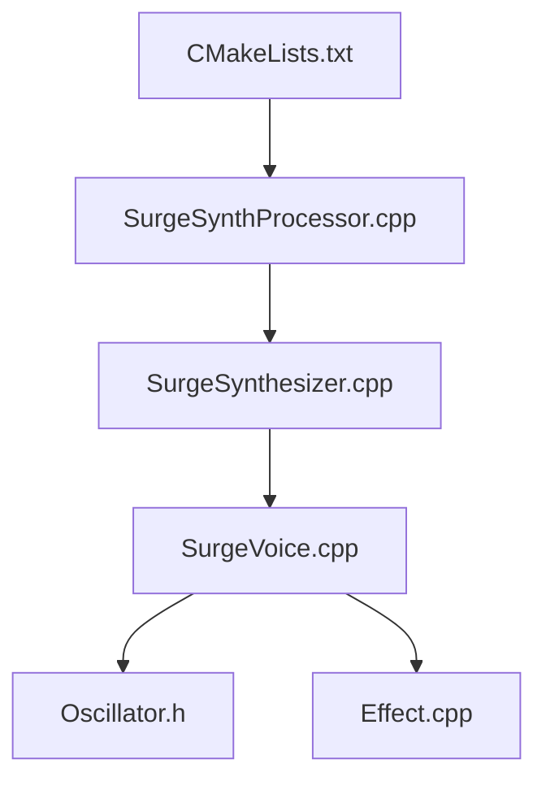

# surge-synthesizer/surge

> Free hybrid synthesizer Surge XT, as a plugin and standalone application for musicians.

## The problem
Musicians are looking for a complete, free, cross-platform synthesizer usable in their audio workstation.

## What it actually does
Produces the Surge XT plugin (VST3, AU, standalone), a Surge FX effects processor, a CLI, a test executable and Python bindings (pybind). C++ engine with oscillators, filters, modulation and effects, controllable via Open Sound Control. The README is mostly a build guide. Musicians must download the binaries from the website.

## How it is wired


## Trying it
```bash
git clone https://github.com/surge-synthesizer/surge.git
cd surge
git submodule update --init --recursive
cmake -Bbuild -DCMAKE_BUILD_TYPE=Release
cmake --build build --config Release --target surge-staged-assets
```

## Cost and gotchas
Free. Building requires CMake and a C++ compiler; no redistributable VST2. GPL-3.0 license.

## What it is not
Not a DSP library to embed in another product, and not an audio ML tool.

## Alternatives
No alternative named in the README.

## For you
Ignore: a musical synthesizer unrelated to data, AI or MLOps work.
