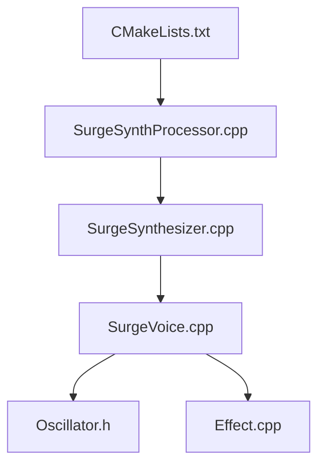

# surge-synthesizer/surge

> Synthétiseur hybride libre Surge XT, en plugin et en application autonome pour musiciens.

## Le problème
Les musiciens cherchent un synthétiseur complet, libre et multiplateforme, utilisable dans leur station audio.

## Ce que ça fait vraiment
Produit le plugin Surge XT (VST3, AU, autonome), un processeur d'effets Surge FX, une CLI, un exécutable de tests et des liaisons Python (pybind). Moteur C++ avec oscillateurs, filtres, modulation et effets, pilotable par Open Sound Control. Le README est surtout un guide de compilation. Les musiciens doivent télécharger les binaires du site.

## Comment c'est branché


## Essayer
```bash
git clone https://github.com/surge-synthesizer/surge.git
cd surge
git submodule update --init --recursive
cmake -Bbuild -DCMAKE_BUILD_TYPE=Release
cmake --build build --config Release --target surge-staged-assets
```

## Coût et pièges
Gratuit. La compilation demande CMake et un compilateur C++ ; pas de VST2 redistribuable. Licence GPL-3.0.

## Ce que ce n'est pas
Pas une bibliothèque de DSP à intégrer dans un autre produit, et pas un outil de ML audio.

## Alternatives
Aucune alternative nommée dans le README.

## Pour toi
À ignorer : synthétiseur musical sans lien avec un travail data, IA ou MLOps.

