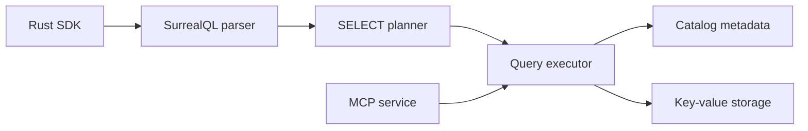

# surrealdb/surrealdb

> Multi-model database in Rust (document, graph, relational, vector) for application and AI agent developers.

## The problem
Stacking a relational database, a graph, a vector index and an API layer multiplies the services to operate and keep in sync.

## What it actually does
A single Rust binary serving a SQL-like language (SurrealQL): documents, typed graph with `RELATE`, time series, geospatial, full-text, vector and hybrid search, live queries, row-level permissions and embedded JavaScript functions. It runs embedded, in WebAssembly, as a single node or as a cluster. An MCP server is announced for agents. GraphQL is "coming soon".

## How it is wired


## Trying it
```bash
docker run --rm --pull always --name surrealdb -p 8000:8000 surrealdb/surrealdb:latest start --log info --user root --pass root memory
```

## Cost and gotchas
Free when self-hosted; managed Cloud is paid. The core is under the Business Source License 1.1, not a free license: read it before any commercial use. The `root/root` credentials in the README should not be kept.

## What it is not
Not a proven replacement for PostgreSQL for critical workloads: the README lists many capabilities without performance figures. The SDKs and libraries are under other licenses, in other repositories.

## Alternatives
No alternatives cited in the README.

## For you
Worth watching: a single engine for graph, vectors and documents can simplify an agent or RAG prototype, but the BSL license and the engine's youth call for testing before adopting.
