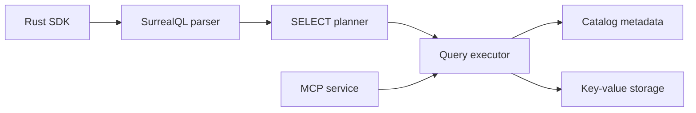

# surrealdb/surrealdb

> Base de données multi-modèle en Rust (document, graphe, relationnel, vecteur) pour développeurs d'applications et d'agents IA.

## Le problème
Empiler une base relationnelle, un graphe, un index vectoriel et une couche API fait multiplier les services à opérer et à synchroniser.

## Ce que ça fait vraiment
Un binaire Rust unique qui sert un langage SQL-like (SurrealQL) : documents, graphe typé avec `RELATE`, séries temporelles, géospatial, recherche plein texte, vectorielle et hybride, requêtes live, permissions par ligne et fonctions JavaScript embarquées. Il tourne embarqué, en WebAssembly, en nœud unique ou en cluster. Un serveur MCP est annoncé pour les agents. GraphQL est « coming soon ».

## Comment c'est branché


## Essayer
```bash
docker run --rm --pull always --name surrealdb -p 8000:8000 surrealdb/surrealdb:latest start --log info --user root --pass root memory
```

## Coût et pièges
Gratuit en auto-hébergement ; Cloud managé payant. Le cœur est sous Business Source License 1.1, pas une licence libre : à lire avant tout usage commercial. Les identifiants `root/root` du README sont à ne pas garder.

## Ce que ce n'est pas
Pas un remplaçant éprouvé de PostgreSQL pour de la charge critique : le README liste beaucoup de capacités sans chiffres de perf. Les SDK et bibliothèques sont sous d'autres licences, dans d'autres dépôts.

## Alternatives
Aucune alternative citée dans le README.

## Pour toi
À surveiller : un seul moteur pour graphe, vecteurs et documents peut simplifier un prototype d'agent ou de RAG, mais la licence BSL et la jeunesse du moteur invitent à tester avant d'adopter.

