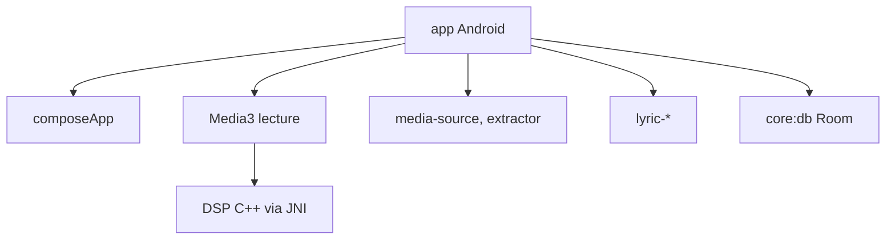

# suvojeet-sengupta/SuvMusic

> Open-source Android music player: streaming, local files, synced lyrics, equalizer.

## The problem
A player that mixes streaming and a local library, with real control over the sound, is not easy to find.

## What it actually does
Kotlin application (Compose, Media3) with native C++ audio processing through JNI: parametric equalizer, spatial audio, normalization. It plays configured YouTube sources, shows synced lyrics, and handles downloads, backups and Spotify import. It offers "Listen Together", Last.fm and Discord Rich Presence.

## How it is wired


## Trying it
```bash
git clone https://github.com/suvojeet-sengupta/SuvMusic.git
cd SuvMusic
./gradlew :app:assembleDebug
./gradlew :app:testDebugUnitTest
```

## Cost and gotchas
Install via APK from the Releases (Android 8.0+). Build: Java 21, NDK 27, CMake 3.22 and SDK 37. Crash diagnostics through ACRA; third-party services depending on options. Respecting copyright is your responsibility.

## What it is not
Not an official YouTube or Spotify app. Not available on iOS: only Android and desktop targets are mentioned.

## Alternatives
No alternative named in the README.

## For you
Ignore: mainstream music player, outside the data / AI / MLOps scope.
