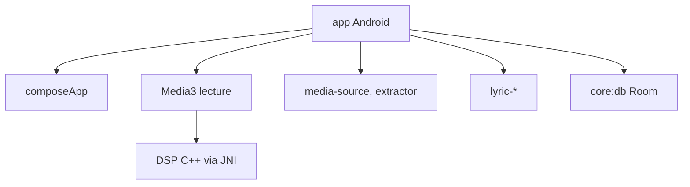

# suvojeet-sengupta/SuvMusic

> Lecteur de musique Android open source : streaming, fichiers locaux, paroles synchronisées, égaliseur.

## Le problème
Un lecteur qui mélange streaming et bibliothèque locale, avec un vrai contrôle du son, n'est pas simple à trouver.

## Ce que ça fait vraiment
Application Kotlin (Compose, Media3) avec traitement audio natif en C++ via JNI : égaliseur paramétrique, audio spatial, normalisation. Elle lit des sources YouTube configurées, affiche des paroles synchronisées, gère téléchargements, sauvegardes et import Spotify. Elle propose « Listen Together », Last.fm et Discord Rich Presence.

## Comment c'est branché


## Essayer
```bash
git clone https://github.com/suvojeet-sengupta/SuvMusic.git
cd SuvMusic
./gradlew :app:assembleDebug
./gradlew :app:testDebugUnitTest
```

## Coût et pièges
Installation par APK depuis les Releases (Android 8.0+). Compilation : Java 21, NDK 27, CMake 3.22 et SDK 37. Diagnostics de crash via ACRA ; services tiers selon les options. Le respect du droit d'auteur reste à ta charge.

## Ce que ce n'est pas
Pas une application officielle de YouTube ou de Spotify. Pas disponible sur iOS : seuls Android et des cibles bureau sont évoqués.

## Alternatives
Aucune alternative nommée dans le README.

## Pour toi
Ignorer : lecteur de musique grand public, hors du périmètre data / IA / MLOps.

