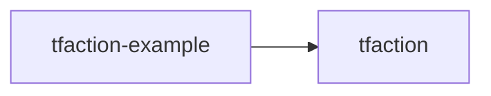

# suzuki-shunsuke/tfaction-example

> Example usage of tfaction, a Terraform automation tool.

## The problem
Not documented: the README describes no problem.

## What it actually does
The README is a single line: "Example usage of tfaction". Nothing else is documented.

## How it is wired
Simplified diagram based on the sheet, no diagram provided.



## Trying it
```bash
# Aucune commande documentée dans le README.
```

## Cost and gotchas
Not documented. You have to read the repository's code to understand the example.

## What it is not
It is not documentation: the README says nothing about tfaction or how it works.

## Alternatives
No alternative named in the README.

## For you
Ignore: insufficient material to judge, and an example without explanation does not help in deciding.
