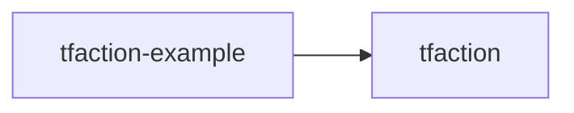

# suzuki-shunsuke/tfaction-example

> Exemple d'usage de tfaction, outil d'automatisation Terraform.

## Le problème
Non documenté : le README ne décrit aucun problème.

## Ce que ça fait vraiment
Le README tient en une ligne : « Example usage of tfaction ». Rien d'autre n'est documenté.

## Comment c'est branché
Schéma simplifié d'après la fiche, sans diagramme fourni.



## Essayer
```bash
# Aucune commande documentée dans le README.
```

## Coût et pièges
Non documenté. Il faut lire le code du dépôt pour comprendre l'exemple.

## Ce que ce n'est pas
Ce n'est pas une documentation : le README ne dit rien de tfaction ni de son fonctionnement.

## Alternatives
Aucune alternative nommée dans le README.

## Pour toi
À ignorer : matière insuffisante pour juger, et un exemple sans explication n'aide pas à décider.

