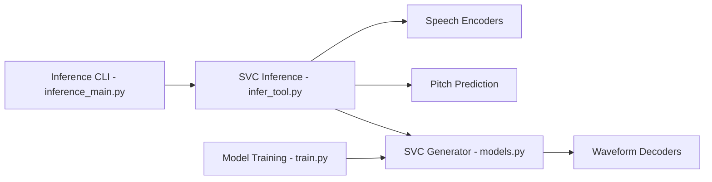

# svc-develop-team/so-vits-svc

> Training and inference framework for singing voice conversion, now archived.

## The problem
Make a target voice sing from a sung recording, without going through text.

## What it actually does
A content encoder (ContentVec, HuBERT, Whisper-PPG...) extracts features that VITS converts while preserving pitch and intonation, with an NSF-HiFiGAN vocoder. Options: "shallow" diffusion, feature retrieval (RVC), timbre clustering, voice mixing, ONNX export. You have to train your own models: none are provided.

## How it is wired


## Trying it
```bash
python resample.py
python preprocess_flist_config.py --speech_encoder vec768l12
python preprocess_hubert_f0.py --f0_predictor dio
python train.py -c configs/config.json -m 44k
python inference_main.py -m "logs/44k/G_30400.pth" -c "configs/config.json" -n "君の知らない物語-src.wav" -t 0 -s "nen"
```

## Cost and gotchas
GPU and clean data required; Python 3.8.9 tested. Repository archived since November 2023, AGPL-3.0. Rights over datasets and voices are the user's responsibility.

## What it is not
Not TTS. Not a ready-to-use product nor intended for production ("academic" use according to the README). Legal risks with real voices.

## Alternatives
- 34j/so-vits-svc-fork: fork with an improved interface.
- w-okada/voice-changer: real-time conversion client.
- MoeVoiceStudio: studio with an f0 editor (ONNX models).

## For you
Ignore: archived, AGPL and legal risk on voices; start from the cited forks if the need is real.
