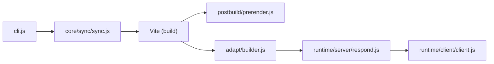

# sveltejs/kit

> Web framework for Svelte applications, with file-based routing, server-side rendering and deployment adapters.

## The problem
Assembling routing, server-side rendering, forms and deployment for a Svelte app takes a lot of glue.

## What it actually does
A monorepo whose core is `packages/kit`, along with adapters (auto, Cloudflare, Netlify, Node, static, Vercel), `enhanced-img` and `package`. Based on the architecture described: a sync step reads the routes and generates the manifests; Vite builds the bundles; a crawler can prerender; an adapter produces the output for the target platform. At runtime, `respond.js` routes to endpoints, pages and actions, and the client handles navigation and remote functions.

## How it is wired

## Trying it
The README contains no SvelteKit installation command; it only cites `npm create vite@latest` and `npm create vite-extra@latest` to reproduce a Vite-related bug.

## Cost and gotchas
Free. Many build problems come from Vite and should be reported separately. Very short README: the documentation is external.

## What it is not
Not a visualization or data tool. It is not a model back end.

## Alternatives
No alternative cited in the README.

## For you
Ignore: general-purpose front-end framework; revisit only to build a web interface on your models if Svelte is already your choice.
