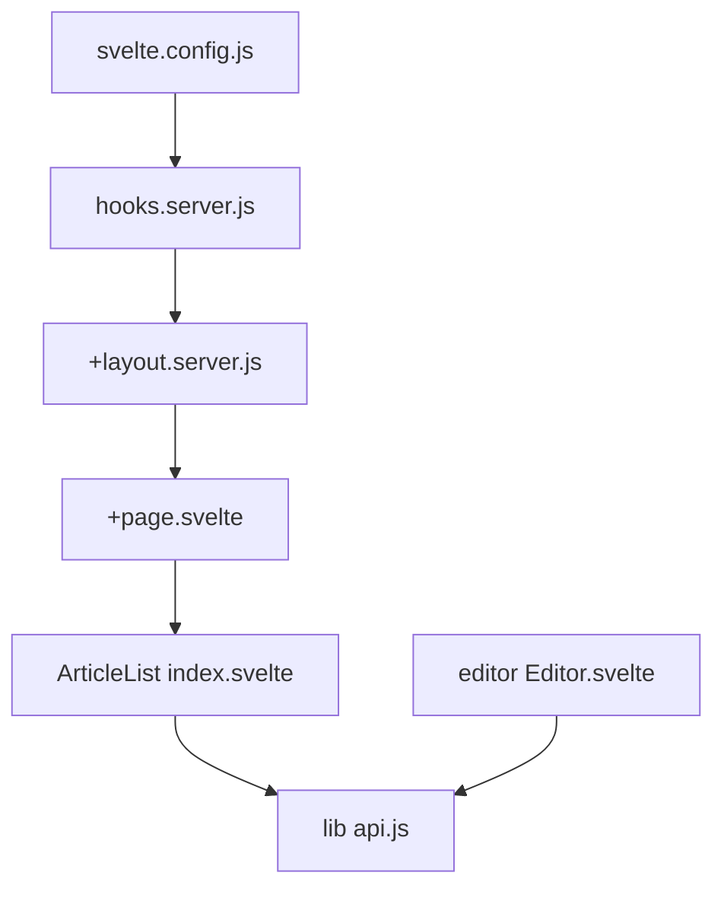

# sveltejs/realworld

> SvelteKit demo application following the RealWorld specification: CRUD, authentication, routing, pagination.

## The problem
Seeing a complete SvelteKit example beyond "hello world".

## What it actually does
A blog clone (articles, editor, login) that calls the RealWorld API through src/lib/api.js. hooks.server.js loads first, then the routes in src/routes: layout, home, article, editor, login. An ArticleList component is shared. The README is only a few lines long.

## How it is wired


## Trying it
```sh
pnpm install
pnpm run dev
pnpm run build
pnpm run preview
```

## Cost and gotchas
Free. Requires Node and pnpm. The README does not say which API server powers the demo.

## What it is not
Not a ready-to-use project template: an educational example.

## Alternatives
The RealWorld repository, to which the README points for other combinations.

## For you
Ignore: a web front-end example unrelated to data or AI, except to learn SvelteKit.
