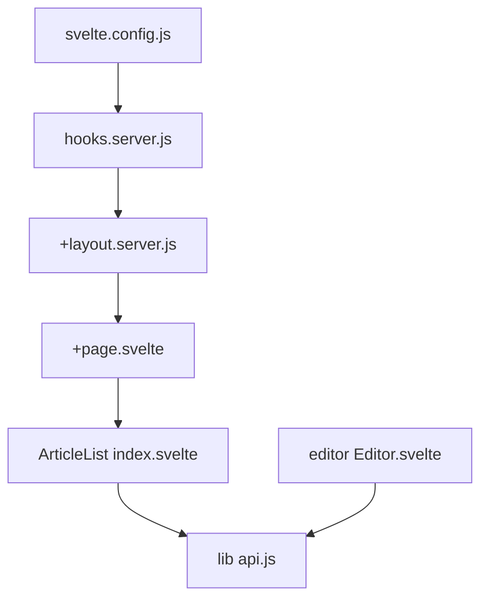

# sveltejs/realworld

> Application SvelteKit de démonstration respectant la spécification RealWorld : CRUD, authentification, routage, pagination.

## Le problème
Voir un exemple complet de SvelteKit au-delà du « hello world ».

## Ce que ça fait vraiment
Un clone de blog (articles, éditeur, connexion) qui appelle l'API RealWorld via src/lib/api.js. hooks.server.js charge d'abord, puis les routes de src/routes : layout, accueil, article, éditeur, connexion. Un composant ArticleList est partagé. Le README tient en quelques lignes.

## Comment c'est branché


## Essayer
```sh
pnpm install
pnpm run dev
pnpm run build
pnpm run preview
```

## Coût et pièges
Gratuit. Il faut Node et pnpm. Le README ne dit pas quel serveur d'API alimente la démo.

## Ce que ce n'est pas
Pas un gabarit de projet prêt à l'emploi : un exemple pédagogique.

## Alternatives
Le dépôt RealWorld, vers lequel le README renvoie pour les autres combinaisons.

## Pour toi
À ignorer : exemple de front web sans rapport avec la data ou l'IA, sauf pour apprendre SvelteKit.

