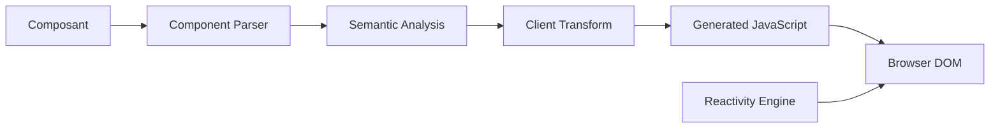

# sveltejs/svelte

> Compiler that turns declarative components into JavaScript that updates the DOM, for front-end developers.

## The problem
Avoiding a heavy framework runtime to update the interface.

## What it actually does
Minimal README: Svelte is a compiler from components to JavaScript that modifies the DOM. According to the architecture: parser, semantic analysis, client, server and CSS transforms, preprocessor, migration, reactivity runtime, server-side rendering.

## How it is wired

## Trying it
No command documented in this README.

## Cost and gotchas
Nothing documented. The README points to the website and Discord.

## What it is not
README too short (under 800 characters) to judge: installation, syntax and limits are not described here.

## Alternatives
No alternative named in the README.

## For you
Watch: of little use for a data/AI profile, except to build a dashboard; material too thin here to decide any further.
